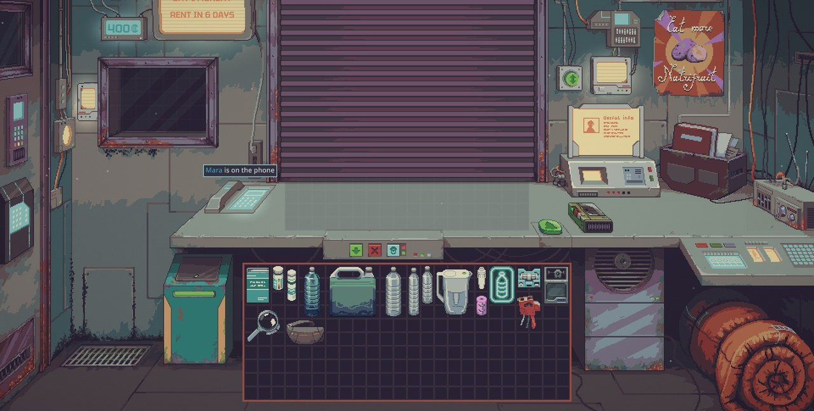
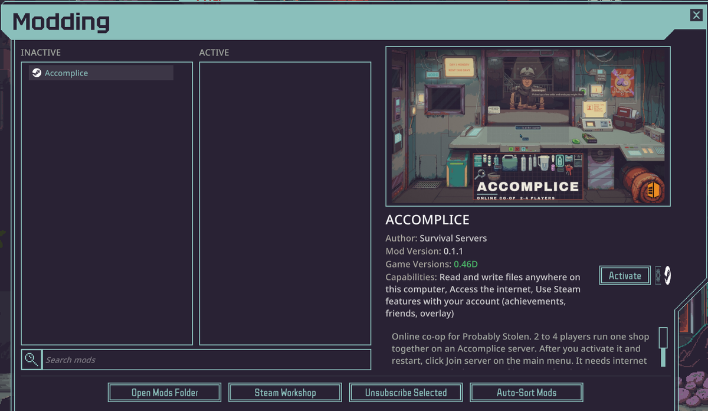
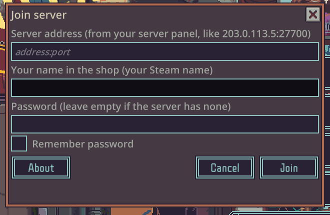

<p align="center">
  <a href="#host-your-own"></a>
  <a href="https://store.steampowered.com/app/4348910/"></a>
  <a href="https://steamcommunity.com/sharedfiles/filedetails/?id=3832445441"></a>
  <a href="LICENSE"></a>
</p>

# AccompliceServer

[Probably Stolen](https://store.steampowered.com/app/4348910/) has no multiplayer. Accomplice adds online co-op: 2 to 4 friends run one shop together on a Probably Stolen dedicated server. This repo is that server.



## Rent a server

[SurvivalServers.com](https://www.survivalservers.com/services/game_servers/probably_stolen/?utm_source=github&utm_medium=readme_install&utm_campaign=accomplice) runs Probably Stolen servers with Accomplice installed and ready to join.

## How to join

Every player needs their own copy of Probably Stolen.

1. Subscribe to [Accomplice on the Steam Workshop](https://steamcommunity.com/sharedfiles/filedetails/?id=3832445441).
2. Start the game, click **Mods**, select **Accomplice**, click **Activate**, then **Yes**. Restart the game.

   

3. Click **Join server** on the main menu, type the server's address and password, and click **Join**.

   

## Host your own

You need a Windows PC that players can reach (a public IP and one open TCP port, 27700 by default) with Probably Stolen installed and Steam signed in.

1. Download `AccompliceServer-<version>.zip` from [Releases](https://github.com/HumanGenome/AccompliceServer/releases/latest) and unzip it into the game folder (the one with `Probably Stolen.exe`).
2. Start the game once, turn on Accomplice in **Mods** as above, then quit.
3. Make a folder for the shop, for example `C:\Shop1`, holding a `server.json` and an empty `data` folder:

   ```json
   { "port": 27700, "name": "My shop", "password": "", "maxPlayers": 4 }
   ```

4. Start the server from the game folder:

   ```
   "Probably Stolen.exe" -batchmode -nographics -logFile "C:\Shop1\player.log" ^
     --br-server --br-config="C:\Shop1\server.json" --br-data="C:\Shop1\data"
   ```

5. Allow the port through Windows Firewall, and forward it on your router if the PC is behind one. Players join with your public IP and the port.

Scenario, difficulty, voice chat, saves and backups: [docs/settings.md](docs/settings.md). Commands and status: [docs/status-and-commands.md](docs/status-and-commands.md).

## Updating

Download the new zip from [Releases](https://github.com/HumanGenome/AccompliceServer/releases/latest) and unzip it over the old files. Players and the server need the same version; if they don't match, the Join window says what to update.

## License

[MIT](LICENSE). Accomplice is a free, unofficial mod, not made by or affiliated with Questing Goose Studio or tinyBuild.
